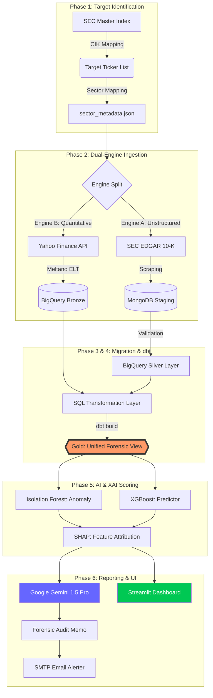
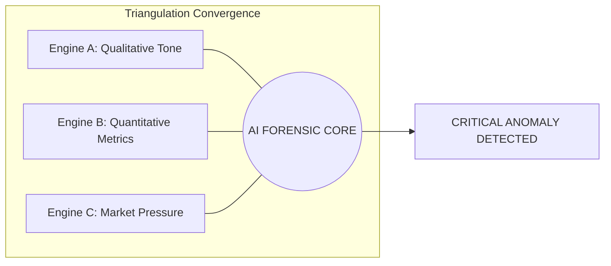

# 🗺️ Forensic Intelligence Platform: Architecture & Data Flow

This document contains the visual blueprints of the **Forensic Intelligence Platform**. Use these diagrams in your presentation to explain the "Triangulation" logic and the "Industrial Data Factory" architecture.

---

## ⚙️ 1. The 6-Phase Industrial Data Flow (Technical)

This diagram tracks the "Lineage" of a forensic audit from raw identification through to AI output.

---

## 🏗️ 2. The Medallion Data Factory Schematic

This demonstrates how the platform maintains **Data Integrity** across the cloud.

| Layer | Technology | Purpose |
| :--- | :--- | :--- |
| **🥉 BRONZE** | MongoDB / BigQuery | **Raw Ingestion**: Permanent storage of messy SEC HTML and raw Yahoo metrics. |
| **🥈 SILVER** | BigQuery | **Standardization**: Data is cleaned, typed, and deduped via SQL. |
| **🥇 GOLD** | dbt + BigQuery | **Analytical Insight**: The final "Fidelity Table" with Benford's and Drift scores. |

---

## 📊 3. Executive Perspective: The Triangulation Principle

For Business Executives (CFO/COO), use this simple logic:

---

## 🖼️ 4. Premium Executive Schematic
*(Marketing-grade 3D visual generated for your presentation deck)*

---

## 🔤 5. Glossary of Visual Terms (Presentation Support)

Use these definitions when explaining the 3D Schematic to non-technical stakeholders:

*   **🏭 INDUSTRIAL DATA FACTORY**: 
    *   *Technical Mapping:* **Dagster Orchestration**.
    *   *Pitch:* "The central brain that manages the 6-phase lifecycle of an audit, ensuring total data traceability."

*   **🎙️ NLP ENGINE (Engine A)**:
    *   *Technical Mapping:* **SEC Text Scraper & Sentiment Logic**.
    *   *Pitch:* "The Qualitative engine that 'listens' to the CEO's tone and disclosures for signs of obfuscation."

*   **📊 QUANT ENGINE (Engine B)**:
    *   *Technical Mapping:* **Meltano ELT & Yahoo Finance Sync**.
    *   *Pitch:* "The Quantitative engine that pulls hard market data to verify if the financials match the narrative."

*   **📈 MARKET DATA TICKERS**:
    *   *Technical Mapping:* **Yahoo Finance API & SEC Ticker Master**.
    *   *Pitch:* "The raw financial pulse of the market—tracking price volatility, short-interest, and debt levels across the entire watchlist."

*   **☁️ BIGQUERY WAREHOUSE**:
    *   *Technical Mapping:* **GCP BigQuery & dbt Transformations**.
    *   *Pitch:* "The secure, high-scale cloud vault where all forensic signals are joined and mathematically validated."

*   **🤖 AI REPORTS**: 
    *   *Technical Mapping:* **Gemini 1.5 Pro & SHAP (XAI)**.
    *   *Pitch:* "The final insight layer that generates professional audit memos with explained proof-of-risk."

---

## 🎤 6. Presentation Narrative Flow (Your Script)

Use this 6-step narrative when walking an audience through the 3D Schematic:

1.  **🚀 RAW SIGNALS**: "Our audit starts with two streams: **SEC FILINGS** (Narrative) and **MARKET DATA TICKERS** (Financials)."
2.  **🏗️ THE DATA FACTORY**: "These enter the **INDUSTRIAL DATA FACTORY** (Dagster), which manages the 6-phase forensic lifecycle."
3.  **🔬 DUAL-PROCESS ENGINE**: "The data is split: The **NLP ENGINE** mines words for 'Fear', while the **QUANT ENGINE** mines numbers for 'Pressure'."
4.  **☁️ CLOUD CONVERGENCE**: "The streams merge in the **BIGQUERY WAREHOUSE** for high-scale SQL transformation and joinery."
5.  **🧠 AI INTELLIGENCE**: "The platform cross-references these signals to generate **AI REPORTS** with explained evidence factors."
6.  **📊 THE COMMAND CENTER**: "The results are visualized in **3D CHARTS** and Heatmaps for immediate auditor triage."

---
