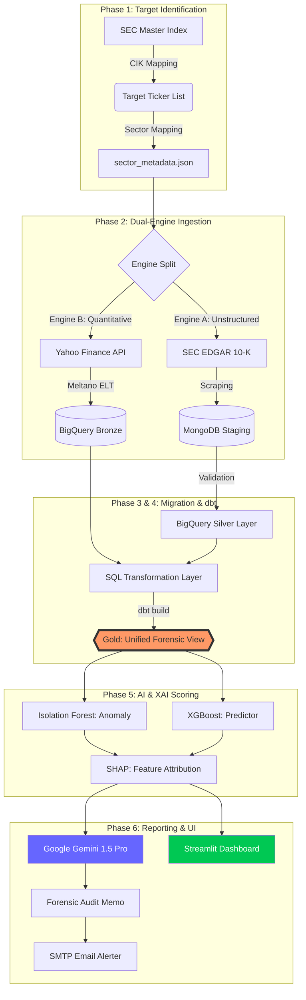
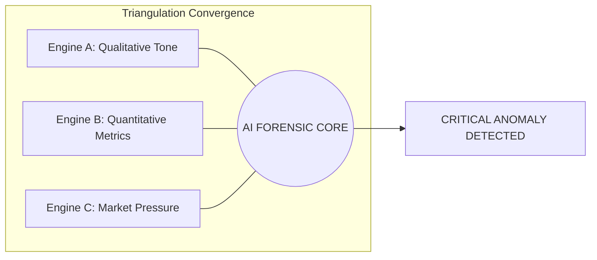
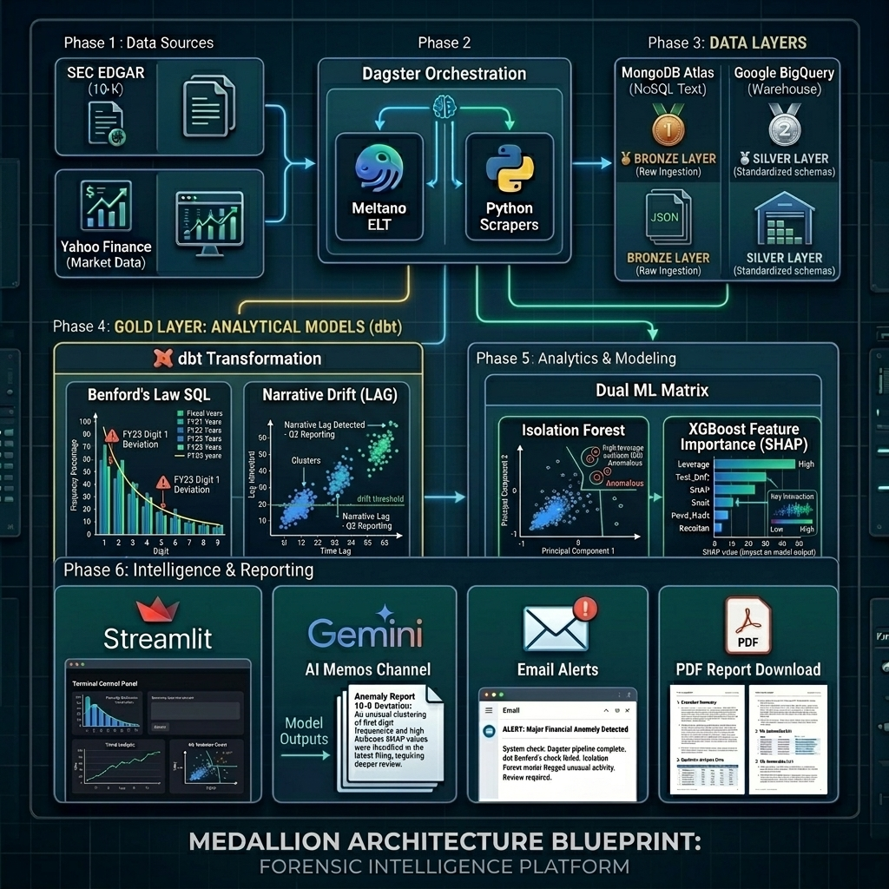

# 🗺️ Capstone Pitch: Architecture & Data Flow

This document contains the visual blueprints of the **Forensic Intelligence Platform**. Use these diagrams in your presentation to explain the "Triangulation" logic and the "Industrial Data Factory" architecture.

---

## ⚙️ 1. The 6-Phase Industrial Data Flow (Technical)

This diagram tracks the "Lineage" of a forensic audit from raw identification through to AI output.

---

## 🏗️ 2. The Medallion Data Factory Schematic

This demonstrates how the platform maintains **Data Integrity** across the cloud.

| Layer | Technology | Purpose |
| :--- | :--- | :--- |
| **🥉 BRONZE** | MongoDB / BigQuery | **Raw Ingestion**: Permanent storage of messy SEC HTML and raw Yahoo metrics. |
| **🥈 SILVER** | BigQuery | **Standardization**: Data is cleaned, typed, and deduped via SQL. |
| **🥇 GOLD** | dbt + BigQuery | **Analytical Insight**: The final "Fidelity Table" with Benford's and Drift scores. |

---

## 📊 3. Executive Perspective: The Triangulation Principle

For Business Executives (CFO/COO), use this simple logic:

## 📐 4. Master Technical Blueprint (The Industrial Grid)
*(High-fidelity engineering schematic for technical defense)*

---

---

## 🔤 5. Glossary of Visual Terms (Presentation Support)

Use these definitions when explaining the 3D Schematic to non-technical stakeholders:

*   **🏭 INDUSTRIAL DATA FACTORY**: 
    *   *Technical Mapping:* **Dagster Orchestration**.
    *   *Pitch:* "The central brain that manages the 6-phase lifecycle of an audit, ensuring total data traceability."

*   **🎙️ NLP ENGINE (Engine A)**:
    *   *Technical Mapping:* **SEC MD&A Scraper & Sentiment Logic**.
    *   *Pitch:* "The Qualitative engine that 'listens' to the **MD&A (Management's Discussion & Analysis)** section for signs of obfuscation and tone-drift."

*   **📊 QUANT ENGINE (Engine B)**:
    *   *Technical Mapping:* **Meltano ELT & Yahoo Finance Sync**.
    *   *Pitch:* "The Quantitative engine that pulls hard market data to verify if the financials match the narrative."

*   **🛰️ MARKET PRESSURE ENGINE (Engine C)**:
    *   *Technical Mapping:* **Yahoo Finance Market Sentiment (Short Ratio & Insider Ownership)**.
    *   *Pitch:* "The 'Wall Street' engine that tracks if professional investors and company insiders are betting on failure, providing a critical cross-check against the CEO's story."

*   **📈 MARKET DATA TICKERS**:
    *   *Technical Mapping:* **Yahoo Finance API & SEC Ticker Master**.
    *   *Pitch:* "The raw financial pulse of the market—tracking price volatility, short-interest, and debt levels across the entire watchlist."

*   **☁️ BIGQUERY WAREHOUSE**:
    *   *Technical Mapping:* **GCP BigQuery & dbt Transformations**.
    *   *Pitch:* "The secure, high-scale cloud vault where all forensic signals are joined and mathematically validated."

*   **🤖 AI REPORTS**: 
    *   *Technical Mapping:* **Gemini 1.5 Pro & SHAP (XAI)**.
    *   *Pitch:* "The final insight layer that generates professional audit memos with explained proof-of-risk."

---

## 🎤 6. Presentation Narrative Flow (Your Script)

Use this 6-step narrative when walking an audience through the 3D Schematic:

1.  **🚀 RAW SIGNALS**: "Our audit starts with two streams: **SEC FILINGS** (Narrative) and **MARKET DATA TICKERS** (Financials)."
2.  **🏗️ THE DATA FACTORY**: "These enter the **INDUSTRIAL DATA FACTORY** (Dagster), which manages the 6-phase forensic lifecycle."
3.  **🔬 DUAL-PROCESS ENGINE**: "The data is split: The **NLP ENGINE** mines words for 'Fear', while the **QUANT ENGINE** mines numbers for 'Pressure'."
4.  **☁️ CLOUD CONVERGENCE**: "The streams merge in the **BIGQUERY WAREHOUSE** for high-scale SQL transformation and joinery."
5.  **🧠 AI INTELLIGENCE**: "The platform cross-references these signals to generate **AI REPORTS** with explained evidence factors."
6.  **📊 THE COMMAND CENTER**: "The results are visualized in **3D CHARTS** and Heatmaps for immediate auditor triage."

---

## 🍳 7. The "Digital Kitchen" Analogy (Simple Explanation)

Use this analogy when explaining the 3D Schematic to non-technical stakeholders (e.g., Business Executives or HR) to make the complex "Cloud Medallion" architecture feel intuitive.

### 🥩 Phase 1: The Raw Ingredients (Inputs)
*   **The Narrative (SEC EDGAR - Engine A)**: Think of this as the "Butcher's Meat"—a 100-page report that’s hard to read and digest.
*   **The Numbers (Yahoo Finance - Engine B)**: These are the "Seasonings & Sides"—the hard data (Margins, Debt) that give the story its flavor.
*   **The Health Inspector (Market Data - Engine C)**: This is "The Word on the Street." If the meat looks good and the seasoning is right, but the Health Inspector (Short Sellers) is closing the place down, you know something is hidden in the kitchen.
*   **The Barcode Scanner (Bottom Yahoo)**: A quick check at the kitchen door to ensure the ingredients are "real" and belong in "this specific recipe" (Sector Mapping).

### 🍱 Phase 2: The Kitchen Manager (Core)
*   **The Head Chef (Dagster)**: The glowing gear in the center. It manages the entire 6-step recipe. If an oven fails or an ingredient is missing, the Chef (Dagster) stops the kitchen immediately to prevent a bad dish.
*   **The Industrial Fridge (BigQuery)**: The high-tech, secure cloud vault where we store all our prepped ingredients.

### 🚿 Phase 3: The Prep Stations (The Tanks)
Ingredients aren’t served raw; they move through a cleaning process:
*   🥉 **BRONZE (The Sink)**: Where we dump the "dirty" raw data from the web.
*   🥈 **SILVER (The Prep Table)**: Where we wash, peel, and chop the data into clean, even pieces (Standardization).
*   🥇 **GOLD (The Plated Dish)**: High-quality, AI-ready data ready to be tasted by the models.

### 🧪 Phase 4: The Lab Equipment (dbt)
*   **The Precision Scale (dbt)**: This performs the "Forensic Math." It checks if the "salt levels" are too high (Benford’s Law) and flags if the Chef is "salting the books."

### 🛎️ Phase 5: Service & Delivery (Output Hub)
*   **The Menu (Dashboard)**: A live screen showing which "dishes" (companies) are burning (Heatmaps).
*   **The Sommelier (Gemini AI)**: An expert that writes a "Forensic Memo" explaining exactly why a certain company is a high-risk outlier.
*   **The Waiter (Email Alerts)**: If something hits the "Smoke Detector," the Waiter pings the auditor’s phone instantly.
*   **The Check (PDF Reports)**: A final, professional document for use as evidence in court or audits.
